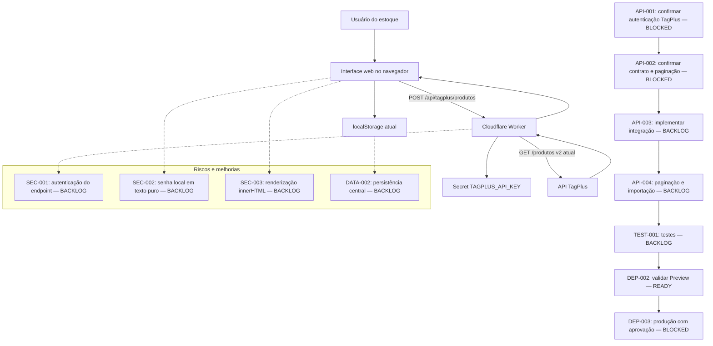

# Mapa do projeto — Estoque Camurça Web

## Legenda
- BACKLOG: ainda não iniciado.
- READY: pronto e sem dependências pendentes.
- IN_PROGRESS: em execução.
- BLOCKED: impedido por dependência ou decisão.
- VALIDATING: implementação feita, aguardando validação.
- DONE: validado com evidência.
- REGRESSED: comportamento anteriormente validado foi quebrado.

## Limites da arquitetura observada
- Um Cloudflare Worker entrega HTML e API.
- A interface é embutida como string HTML em `estoque-web/worker.js`.
- O navegador mantém produtos e senha em localStorage.
- O Worker consulta a TagPlus usando segredo configurado no ambiente.
- Não foi observada uma base de dados central nem autenticação de sessão no servidor.
